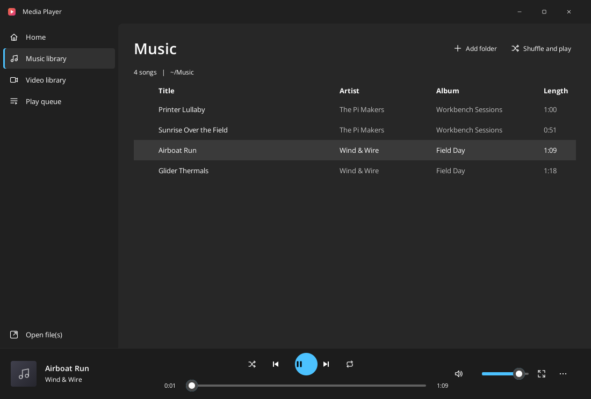
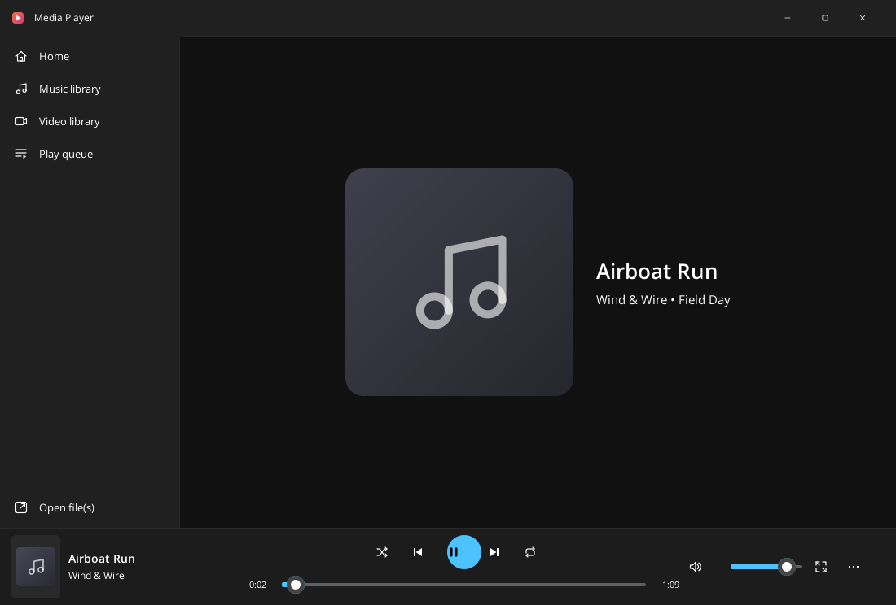
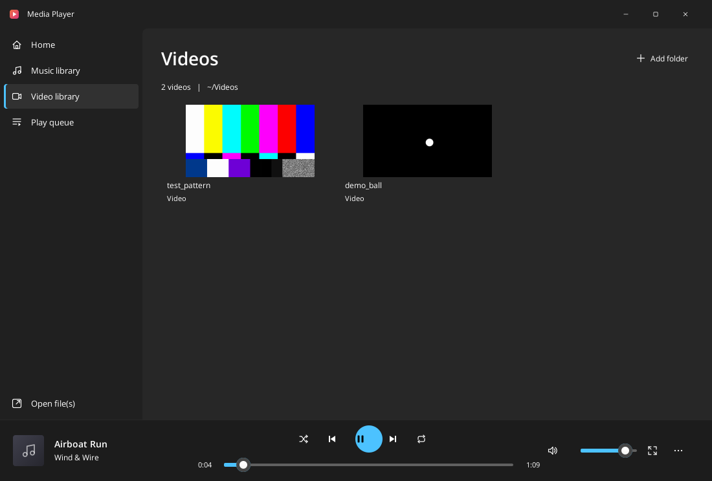
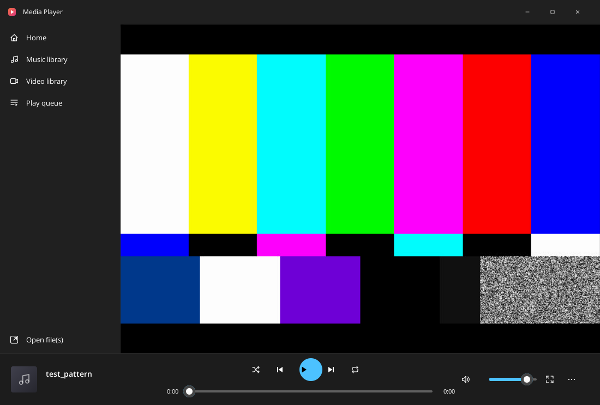

# pi-mediaplayer

A Windows 11 Media Player style Media Player app for the Raspberry Pi (built for the Pi 5, works on other Pis running Raspberry Pi OS). Native GTK app with the Windows 11 dark look, made to match [pi-explorer](https://github.com/wvfouram/pi-explorer) and [pi-taskmgr](https://github.com/wvfouram/pi-taskmgr).



## Features

- **Music library** from your Music folder with title, artist, album and length read from the files, sorted by artist and album
- **Video library** from your Videos folder with thumbnails
- **Play queue**, play next, add to queue, shuffle, repeat all / repeat one
- **Player bar** with album art, seek bar, volume, mute and full screen
- **Now playing** page with large album art, or the video
- Add more folders to either library, open files or drag files and folders onto the window
- Playback speed (0.5x to 2x), keyboard and media key control
- Plays MP3, FLAC, OGG, OPUS, WAV, M4A/AAC, MP4, MKV, WEBM, MOV, AVI and more through GStreamer





## Install

In a terminal on the Pi (as your normal user, not with sudo):

```
git clone https://github.com/wvfouram/pi-mediaplayer.git && bash pi-mediaplayer/install.sh
```

Then open **Media Player** from the menu, or run `pi-mediaplayer`.

Becomes the default app for music and video files. Uninstalling puts the previous app back.

To update later:

```
cd ~/pi-mediaplayer && git pull && bash install.sh
```

## Keyboard shortcuts

| Keys | Action |
|---|---|
| Space or Ctrl+P | Play / pause |
| Ctrl+F / Ctrl+B | Next / previous |
| Right / Left | Forward / back 10 seconds |
| Up / Down | Volume |
| M | Mute |
| F11 | Full screen |
| Ctrl+O | Open file(s) |

## Uninstall

```
bash pi-mediaplayer/uninstall.sh
```

## License

MIT
